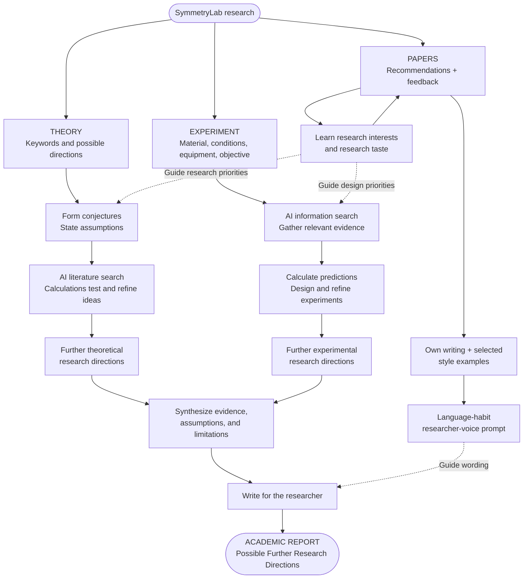
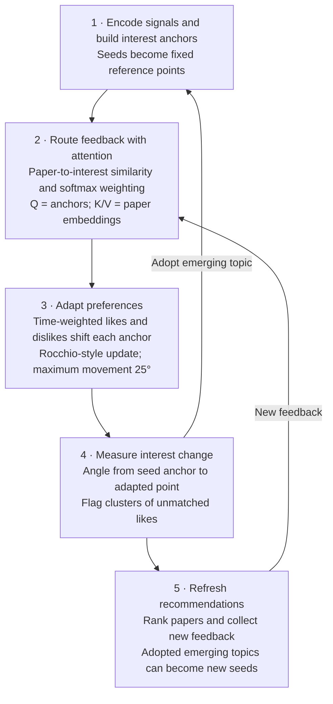

# SymmetryLab: Research Workflows and Interest Adaptation

Updated: 2026-10-23 (Asia/Shanghai). Based on the current discovery-preview implementation.

## Figure 1. Personalized research workflow

The diagram groups the system into three modules: Theory and Experiment are research paths; Papers learns research taste and produces the language-habit prompt used when writing either report.

Each research path can produce the report independently. Research-taste context guides what to investigate; the researcher-voice prompt guides how to write the result. In the current implementation, it is optional wording-profile data for a post-research editor pass under a fixed scientific-editor policy.

## Figure 2. Modular interest adaptation algorithm

This view groups the calculation into five major modules and highlights the attention analogy and the meaning of drift.

**Drift measurement.** For reference seed anchor \(a_j\) and adapted interest point \(p_j\), calculate \(\theta_j=\arccos(\operatorname{clip}(a_j^\top p_j,-1,1))\cdot180/\pi\). Report the angle for each interest and the maximum across interests. Adaptation is capped at 25° from the seed anchor; this is total displacement, not movement since the previous update.

Unmatched liked papers provide a separate emerging-interest signal: the unexplained share is unmatched likes divided by all likes. It is distinct from angular drift, which measures movement within existing interests.

**Transformer connection.** The routing step borrows query-key similarity, a masked temperature softmax, and value-weighted aggregation: anchors act as queries, paper vectors as keys and values. The softmax distributes each feedback paper across eligible interests. There are no learned Q/K/V projections, attention heads, or feedback training; the subsequent signed Rocchio update and angular cap are separate algorithms.

## Implementation references and boundaries

- [Interest algorithm](../src/symmetrylab/literature/profile.py): anchor construction, routing, decay, update, cap, emerging interests, and matching.
- [Paper service](../src/symmetrylab/literature/service.py): feedback reconstruction, ranking, keyword adoption, and writing-profile lifecycle.
- [Encoders](../src/symmetrylab/literature/encoders.py) and [ranking](../src/symmetrylab/literature/ranking.py): representations and score components.
- [Personalization](../src/symmetrylab/literature/personalization.py), [style extraction](../src/symmetrylab/literature/style.py), and [writing pass](../src/symmetrylab/agent_core/writing.py): taste context, voice specification, and optional editing.
- [Implementation status](implementation_status.md): this is a conditional research prototype; material-specific predictions, live acceptance, ranking calibration, and voice-profile effects on real-model prose are not established.
