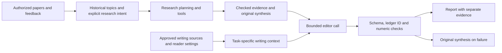

# LaMP and Researcher Personalization: Methods, Limits, and SymmetryLab Design

Review date: 2026-10-23. This document distinguishes published methods, newer preprints, our engineering choices, and unmeasured hypotheses. It does not claim that benchmark improvements transfer automatically to condensed-matter research.

## 1. What LaMP contributes

LaMP, introduced at ACL 2024, frames personalized prediction as conditioning on an input and a user's historical profile. Its seven tasks cover citation choice, movie tagging, ratings, news headlines, scholarly titles, email subjects and tweet paraphrasing. Retrieval selects a small subset of history for each input. The paper studies in-prompt augmentation and fusion-in-decoder approaches, with term-based, semantic and time-aware retrieval. It provides user-separated and time-separated evaluation settings. The current dataset page replaces an older news-categorization version of task 2 with movie tagging. [Paper](https://aclanthology.org/2024.acl-long.399/), [dataset versions](https://lamp-benchmark.github.io/download).

A useful abstraction is:

`selected_history = retrieve(current_task, user_history, k)`

`answer = model(current_task, selected_history)`

For SymmetryLab, the personal store contains authorized papers, explicit research preferences, writing examples and feedback. The evidence store contains calculations, assumptions and external scientific sources. These stores have different authority: a preference can determine which question to investigate or how to explain an answer, but cannot determine whether a claim is true.

Our practical adaptation is to combine a stable researcher profile with a small task-specific selection. In-prompt retrieval works with our existing model API. Fusion-in-decoder requires a suitable model architecture and execution setup; it is not a feature that can simply be enabled on an arbitrary chat endpoint.

## 2. Why personalization is not just similar-paper search

A physics paper can reveal several distinct signals:

| Signal | Example | How to use it |
|---|---|---|
| Historical expertise | Work on magnetic group representations | Supply familiar terminology and relevant context |
| Research interest | Current interest in transport constraints | Retrieve related problems and mechanisms |
| Method preference | Prefers exact arguments and minimal models | Rank candidate research directions by methodological fit |
| Writing preference | States assumptions before a result | Select matching rhetorical examples |
| Current task | Design a measurement with limited equipment | Apply present feasibility constraints |

These are our application distinctions, not labels provided by LaMP. A citation or topic match does not identify all of them. We therefore retain explicit user fields and evidence-linked topic mentions instead of treating an embedding as a complete model of taste.

User-separated evaluation asks whether a personalization procedure works for new people. A temporal design asks whether earlier information supports later behavior. For our study, both should also group duplicate versions of papers and hold out evaluation passages. Otherwise a memorized title, near-duplicate abstract or already-voted candidate can inflate apparent personalization quality.

## 3. Follow-up work and what to borrow

### Retrieval optimization: choose history that actually helps

Salemi, Kallumadi and Zamani's SIGIR 2024 work optimizes personal-history retrieval using downstream generation feedback. It develops reinforcement-learning and knowledge-distillation approaches and also studies selecting a retriever for a particular input. The relevant distinction is between finding semantically similar history and finding history useful to the final task. [Primary paper](https://arxiv.org/abs/2404.05970).

**Adaptation:** log which examples were selected, their profile version and the researcher's preference between outputs. Evaluate candidate retrievers with the same generator, factual inputs and budget. A passage should earn value from better final explanations or decisions, not merely from high cosine similarity. Start by tuning a small reranker; use RL only when reliable rewards and held-out cases exist. This optimization is proposed, not implemented in the current release.

### Guided Profile Generation: ask targeted questions of history

Guided Profile Generation introduces an intermediate natural-language profile produced with guiding questions, rather than directly presenting raw personal context. The aim is to preserve distinctive habits and preferences in a concise representation. [Paper](https://arxiv.org/abs/2409.13093).

**Adaptation:** use questions such as “Which mechanisms recur?”, “Which methods are preferred?”, and “How are assumptions introduced?” Each answer should carry a supporting passage and an inferred/confirmed status. Our implementation adds explicit question/method/goal/taste fields and literal historical facets. It does not yet run an LLM to infer a full guided profile. This conservative first step prevents the model from presenting plausible but unsupported preferences as established facts.

### What matters inside a profile: preserve approved outputs

Wu and colleagues study which parts of a profile contribute to personalization. Their experiments identify historical user-produced or approved responses as important signals and investigate sensitivity to where profile information appears in the prompt. These are empirical results for their settings, not universal placement rules for every model. [Paper](https://arxiv.org/abs/2406.17803).

**Adaptation:** an edited paragraph that the researcher approves is a stronger direct writing signal than a content like. The new UI therefore records writing-source selections and approved paragraphs separately. A later edit-memory system should preserve the original text, the accepted edit and a reason such as “missing assumption” or “redundant background.” Do not infer a global writing rule from one deletion without its task context.

### LongLaMP: evaluate whole passages

LongLaMP expands personalized generation to longer outputs through email completion, abstract generation, review writing and topic writing. Its evaluation includes user and temporal settings. It addresses a different problem scale from short titles or labels. [Paper](https://arxiv.org/html/2407.11016v1), [project](https://longlamp-benchmark.github.io/).

**Adaptation:** our benchmark should evaluate complete explanations and research summaries, including transitions, repeated definitions, argument progression and qualification of conclusions. A successful first sentence is insufficient. Scientific abstract generation is especially relevant, but our derivations and experiment proposals also require proof/feasibility checks absent from generic text-generation scores. The current editor changes one synthesis; it is not yet a full manuscript editor.

### LaMP-QA: personalize explanatory answers

LaMP-QA, published at EMNLP 2025, studies personalized long-form answers. It covers Arts & Entertainment, Lifestyle & Personal Development, and Society & Culture, with over 45 subcategories, and compares automatic evaluation with human judgments. Its domain is not scientific verification. [Paper](https://aclanthology.org/2025.emnlp-main.60/).

**Adaptation:** hold the scientific evidence fixed while varying the reader's knowledge, goal and desired detail. A physicist from another subfield may need a definition and a short implication; a specialist may need only the limiting assumption. Evaluate both unnecessary background and omitted reasoning. Personalization should alter the explanation plan without changing the evidence-supported conclusion.

### StyleVector: disentangle style from scientific subject matter

The ACL 2025 StyleVector work represents personal writing style through contrastive activation steering, addressing entanglement between semantic content and stylistic patterns. It manipulates model activations rather than relying only on retrieved prompts. [Paper](https://aclanthology.org/2025.acl-long.353/).

**Adaptation:** the design lesson is to avoid measuring style by shared physics words. Compare texts that express the same facts in different styles and different facts in comparable rhetorical styles. The activation-steering method requires model-internal access, so our custom text API cannot implement it directly. Keep it as an option for a future locally hosted model, not a promise for the current API-based application.

### BUMP: a possible future profile-learning objective

The June 2026 BUMP preprint trains a profile generator with GRPO using bidirectional ranking: the profile should rank its user's held-out interactions, and an interaction should identify the matching profile among alternatives. A frozen model scores rankings with multi-positive NDCG; other users supply negatives. [Preprint](https://arxiv.org/abs/2606.05336).

**Adaptation:** a useful research taste profile should predict unseen preferences rather than merely summarize familiar vocabulary. However, user identification can exploit topic cues without capturing scientific judgment. We would need same-subfield hard negatives, consented interaction data, time-held-out evaluation and human checks. Two teammates do not supply a robust population for this training. This is a future research route, not implemented RSI or demonstrated improvement.

### TAP-PER: persistent state plus query-dependent interests

The 2026 TAP-PER preprint uses temporal, query-conditioned prefix representations to reduce reliance on serialized histories and per-user adapters. It separates persistent user state from input-specific conditioning. [Preprint](https://arxiv.org/abs/2606.04547).

**Adaptation:** the conceptual split is useful now: preserve long-term research context while allowing the current project to override it. Learned soft prefixes require model access beyond the current text API, so we implement the distinction with explicit fields and bounded textual context instead.

## 4. What has been implemented in SymmetryLab

The current implementation borrows architectural ideas rather than reproducing the research systems or their reported scores:

- Layered research intent: questions, methods, current goal and taste/exclusions.
- Source-linked historical facets for symmetry, method, observable and system, using literal lexicon matches.
- Balanced retrieval-query coverage, rotating keyword slots, and positive-feedback-derived query terms.
- Transparent hybrid ranking: anchored similarity plus BM25 and explicit content votes. Weights are engineering defaults.
- A separate, opt-in interest packet passed into planning, with a hash and provenance. It supports traceable taste hypotheses.
- Independent content feedback and writing-source selection.
- Audience, section, explanation depth, writing notes and up to eight approved paragraph samples.
- Corpus fingerprints and stale-profile refusal; keyword-only voice construction is rejected.
- A task-specific selection of up to two paragraphs, preferring matching sections.
- One post-research writing call within existing budgets. The original synthesis survives failure or rejection; checked facts are retained independently.

The editor checks schema, complete ledger references and unexpected numeric tokens. These are intentionally reported as partial checks: they cannot prove preservation of every negation, scientific condition or causal statement. Edited prose remains unverified model synthesis. The agent never updates its verifier or relabels mathematical evidence to satisfy a personal preference.

## 5. A benchmark suited to this project

### Interest and direction choice

Collect a pilot corpus with same-topic hard negatives, cross-material methodological positives and historical/current-interest conflicts. Record graded relevance, usefulness and reasons from the researcher. Separate seeds, feedback and held-out candidates, and group preprint/journal duplicates.

Compare keyword-only retrieval, the old semantic ranker, the new hybrid baseline and later profile-aware rerankers. Evaluate retrieval recall separately from candidate ranking. Report nDCG@10, useful-paper Precision@10, relevant-facet diversity, corrections to inferred preferences, latency and model cost. Evaluate whether feedback helps unseen candidates, not just the voted item.

### Scientific writing

Use the same verified evidence packet for four conditions: generic prompt; the earlier static voice prompt; field conventions plus reader settings; and task-matched personal examples plus settings. Keep model, factual input, output budget and audience fixed. Randomize/blind pair ordering.

Have the target researcher judge preference fit and a domain reader judge scientific communication. Score professional wording, redundancy, missing premises, unsupported claims and preserved conditions separately. Track edits required for acceptance. Evaluate complete passages and include a held-out section type to test generalization.

Content-controlled evaluation is important because topic overlap can masquerade as style matching; STEL provides a methodological reference for that distinction. [STEL](https://aclanthology.org/2021.emnlp-main.569/).

### Adaptive improvement

A suitable first loop is: record a human correction → propose a narrowly scoped profile change → test it on held-out cases → retain it only if preference improves without degrading fidelity. Version every profile and keep rollback available. Later, a retriever or profile generator could be trained on these signals. Popularity, user-identification accuracy, ROUGE or an LLM judge alone must not become a substitute for scientific correctness.

## 6. What is still unproven

Validation on 2026-10-23: 122 tests passed and one optional test was skipped. Python compilation, JavaScript syntax checking and `git diff --check` passed. Tests cover independent interest/style signals, stale profiles, planning-context delivery, memory isolation across profile versions, and bounded editor fallback. These are engineering regression results, not measured personalization gains.

No real-user ranking gain, writing preference gain, weight-training benefit or RSI improvement has been established by this implementation. Regression tests use synthetic fixtures and model doubles. Full-text segmentation, a curated consensus/notation registry, learned rerankers, edit-memory learning and expert blind evaluations remain future work.

The recommended next experiment is a small, carefully labelled two-researcher pilot. It can justify the next engineering decision; it cannot establish broad generalization across physicists.
